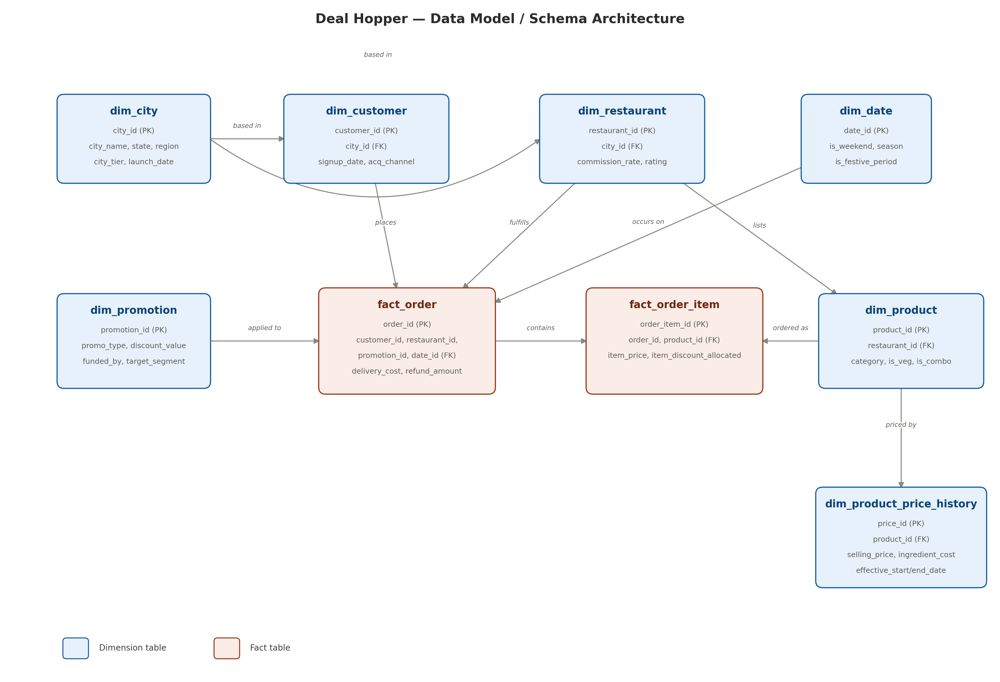
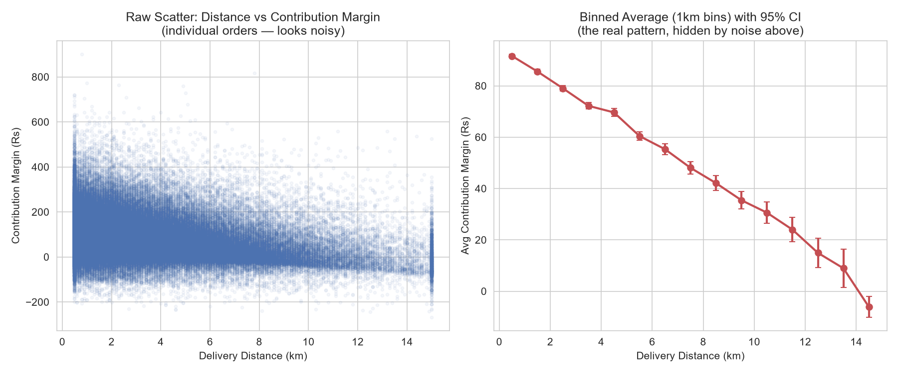
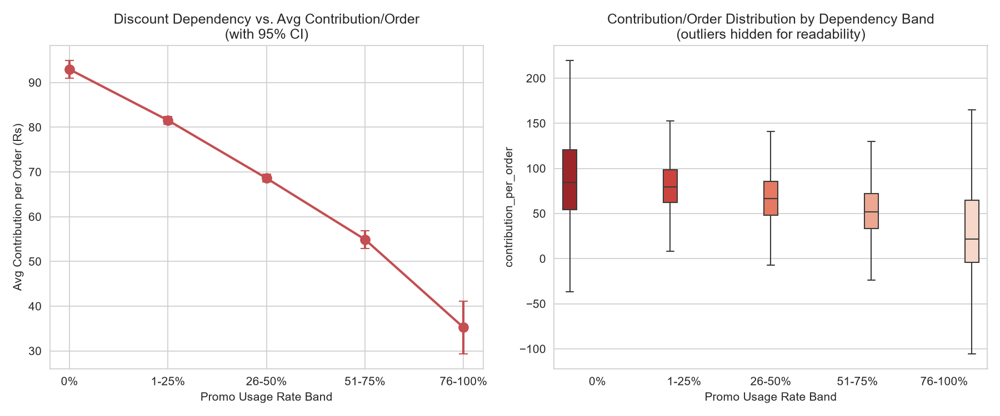
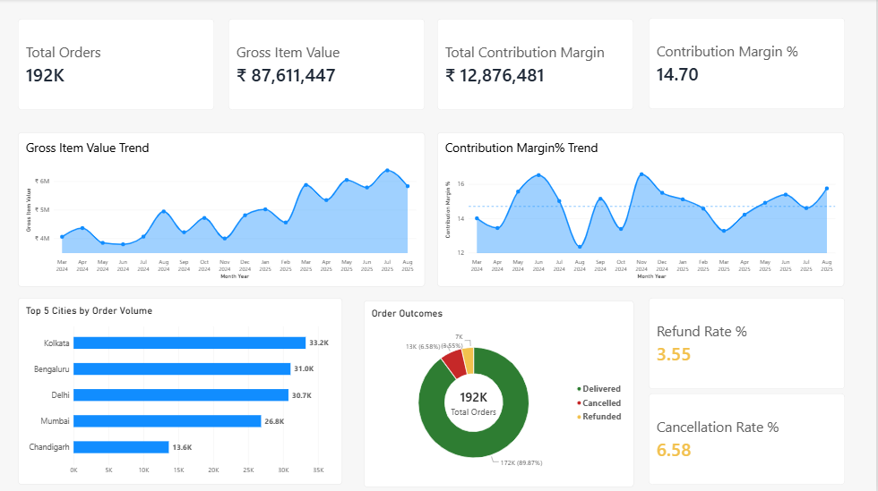
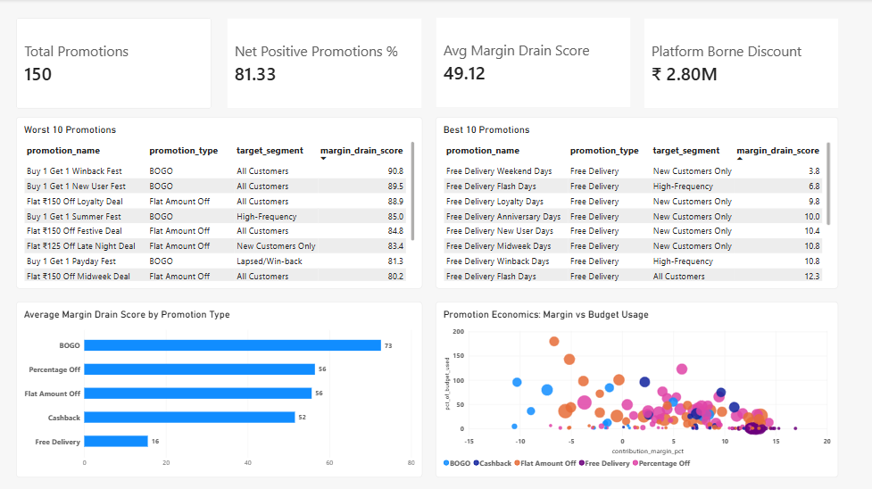
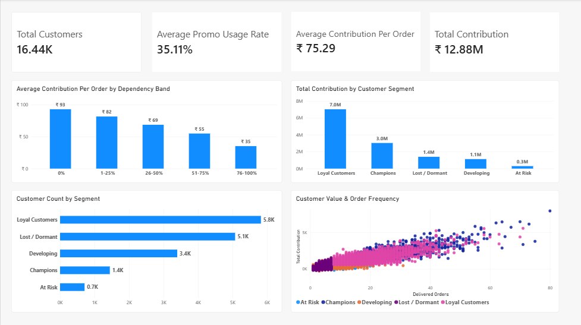

# Deal Hopper — Margin Drain Intelligence

**An end-to-end data analytics project analyzing whether promotional
discounts on a food-delivery marketplace drive profitable growth, or
quietly drain margin.**

Built as a full pipeline: synthetic data generation (Python) → relational
modeling (PostgreSQL) → SQL analysis → statistical EDA (Python) →
composite scoring → interactive dashboard (Power BI).

---

## The Business Question

> Is Deal Hopper's promotional strategy creating profitable growth, or
> buying revenue at the cost of margin?

Deal Hopper is a fictional food-delivery marketplace (inspired by, but
independent of, real Indian platforms). It runs frequent promotions to
drive order volume — but not all growth is profitable. This project
identifies **where margin is leaking, quantifies the financial impact,
and recommends which promotions to scale, redesign, or stop.**

---

## Key Findings

| Finding | Evidence |
|---|---|
| **Discount-dependent customers are worth less than half as much per order** | ₹92.93 (never discount) → ₹35.23 (76-100% discount usage), monotonic across every band |
| **Order frequency does NOT predict profitability** | Contribution/order stays flat (~₹74-76) across all frequency quartiles — a counter-intuitive, board-relevant finding |
| **BOGO promotions are net-negative overall**; Free Delivery is the most efficient lever | 13.26% contribution margin (Free Delivery) vs. -0.05% (BOGO), independently confirmed via SQL, a statistical t-test (p≈0, Cohen's d=0.76), and Power BI DAX |
| **Contribution margin collapses with delivery distance** | ₹89 (0-2km) → ₹16 (10km+), a near-linear decline hidden by a weak raw correlation (-0.21) but obvious once binned |
| **High product margin ≠ high platform profitability** | The single highest-volume restaurant on the platform (Bakery & Desserts) contributes just ₹19.61/order — low AOV + fixed delivery cost squeezes platform margin despite strong food-level margins |

Full analysis, charts, and SQL underlying every finding: see [`python_eda/outputs/`](python_eda/outputs/) and the SQL/Python files referenced in [`SETUP.md`](SETUP.md).

**Sample charts:**

 

---

## Power BI Dashboards

### 1. Overall Business Analytics

Overview of order volume, gross item value, contribution margin, monthly trends, and order outcomes.

### 2. Promotion Margin Drain Analysis

Analyzes promotion profitability, highlights the best and worst promotions, and compares margin drain scores across promotion types.

### 3. Customer Segmentation & Discount Dependency

Explores customer segments, promotion usage behavior, average contribution per order, and customer value.

## Tech Stack

| Layer | Tools |
|---|---|
| Data generation | Python (pandas, numpy) — fully reproducible, seeded synthetic data |
| Database | PostgreSQL |
| Analysis | SQL (CTEs, window functions, views) — 31 scripts across 5 stages |
| Statistical EDA | Python (pandas, seaborn, scipy — t-tests, correlation, IQR outlier detection) |
| Dashboard | Power BI (DAX measures over a raw star schema, not pre-aggregated views) |

---

## Architecture

- **Star schema**: 6 dimension tables + 2 fact tables (order-item grain),
  ~625,000 total fact rows across an 18-month window (Mar 2024–Aug 2025),
  12 cities across 5 Indian regions
- **The Margin Drain Score**: a composite 0-100 score per promotion,
  combining contribution margin %, discount efficiency, budget overrun,
  refund/cancellation rate, and customer discount-dependency via
  percentile ranking (`PERCENT_RANK()`)
- Full schema design rationale, generation logic, and validation approach:
  see [`SETUP.md`](SETUP.md)

---

## Known Issues & Debugging Notes

Documenting real bugs found and fixed during this project, since catching
and explaining them is as valuable as the analysis itself:

- **Cross-table timing bug**: orders could initially be assigned to
  restaurants that hadn't onboarded yet on that order's date. Found via a
  dedicated cross-table validation pass (Stage 5), not caught by per-table
  checks alone. Fixed with a `bisect`-based point-in-time restaurant filter.
- **SQL fan-out bug**: an early validation query joined item-level and
  order-level data in one flat query, silently duplicating order-level
  costs once per line item on multi-item orders. Fixed by aggregating each
  side at its natural grain before combining.
- **Inverted `PERCENT_RANK()` sort directions**: the Margin Drain Score
  initially ranked every factor backwards (best promotions scored as
  "worst"), because `PERCENT_RANK() OVER (ORDER BY x ASC)` gives the
  *smallest* x a percentile near 0, not near 1. Caught by validating the
  new composite score against ground truth already established in earlier
  SQL/Python analysis — not by inspection alone.
- **Power BI ambiguous relationship paths**: the star schema has two
  independent "diamond" cycles (`dim_restaurant`↔`dim_product` via
  `fact_order_item`, and `dim_city`↔`dim_customer` via `fact_order`).
  Diagnosed by modeling the relationship graph and confirming
  mathematically (`edges - nodes + 1`) that exactly two relationships
  needed deactivating, then choosing which two based on which paths were
  actually load-bearing for the DAX measures.

---

## Setup / Reproduction

See [`SETUP.md`](SETUP.md) for the full step-by-step guide (Python
environment, PostgreSQL setup, running each generation/SQL/EDA script in
order, and connecting Power BI).

---

## License

For portfolio and educational purposes.
